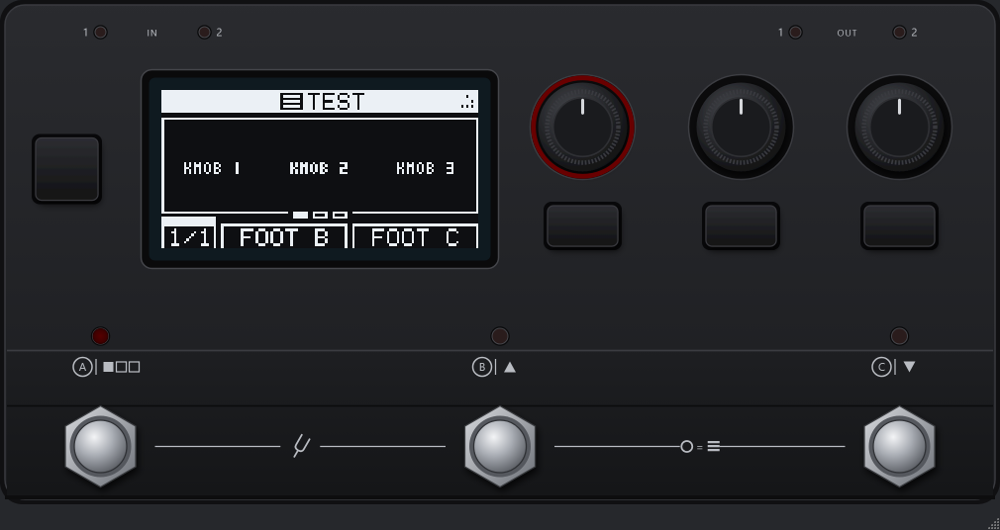

# mod-hw-emulator

Runs the real MOD controller firmware (MOD Dwarf, Duo X and Duo) on a desktop computer, to develop HMI features —
[aLabs HMI widgets](https://github.com/sejerpz/alabs-hmi-widgets) first — together with mod-desktop.

Experimental. See [DESIGN.md](DESIGN.md) for how it works.

## Build

Needs GCC or Clang (MinGW on Windows), GNU make and git.

```sh
git submodule update --init --recursive --depth 1 deps/mod-dwarf-controller deps/mod-duox-controller \
    deps/mod-duo-controller deps/mod-system-control
make                           # build/fw-dwarf.so (.dll/.dylib) and build/mhe-run
```

The firmware is built from `deps/mod-dwarf-controller`, a checkout of
[sejerpz/mod-dwarf-controller](https://github.com/sejerpz/mod-dwarf-controller) on branch
`feature/mod-hw-emulator` (`feature/hmi-widgets` plus fixes found with the emulator, and its protocol
submodule on the widgets and ui-config branches merged); `make FW_DWARF=path` for another checkout. Its
protocol submodule names its URL over SSH: without an SSH key for GitHub,
`git config --global url."https://github.com/".insteadOf git@github.com:` first.

### Sources: the submodules in deps/

What the emulator and its packages are built with is in `deps/`, one shallow submodule (`shallow = true`)
each, on the branch it follows:

| Submodule | Repository, branch | For |
|---|---|---|
| `deps/mod-dwarf-controller` | [sejerpz/mod-dwarf-controller](https://github.com/sejerpz/mod-dwarf-controller) `feature/mod-hw-emulator` | the Dwarf firmware (`FW_DWARF`) |
| `deps/mod-duox-controller` | [sejerpz/mod-duox-controller](https://github.com/sejerpz/mod-duox-controller) `devel` | the Duo X firmware (`FW_DUOX`), with the HMI widgets |
| `deps/mod-duo-controller` | [sejerpz/mod-duo-controller](https://github.com/sejerpz/mod-duo-controller) `feature/mod-hw-emulator` | the Duo firmware (`FW_DUO`) |
| `deps/mod-system-control` | [sejerpz/mod-system-control](https://github.com/sejerpz/mod-system-control) `feature/hmi-widgets` | `sys_host.c` in the hosts (`MSC`) |
| `deps/mod-host` | [sejerpz/mod-host](https://github.com/sejerpz/mod-host) `feature/mod-hw-emulator` | mod-host of the packages, `scripts/run-mod-host.sh` (`MOD_HOST`) |
| `deps/mod-desktop` | [sejerpz/mod-desktop](https://github.com/sejerpz/mod-desktop) `feature/mod-hw-emulator` | MOD Desktop of the packages, with [sejerpz/mod-ui](https://github.com/sejerpz/mod-ui) `feature/mod-hw-emulator` as its `src/mod-ui` |

Each commit of mod-hw-emulator pins the commit of each one, and the packages are built from those: a tag
builds the same sources again. `git clone --recursive` takes them all, MOD Desktop's many submodules
included; for the emulator alone take only the firmwares and mod-system-control, as above. mod-host and
mod-ui (below) come with their submodules:

```sh
git submodule update --init --depth 1 deps/mod-host
git submodule update --init --depth 1 deps/mod-desktop
git -C deps/mod-desktop submodule update --init --depth 1 src/mod-ui
make -C deps/mod-desktop/src/mod-ui/utils   # mod-ui's utils library
cd deps/mod-desktop/src/mod-ui              # its Python environment, modui-env/ (scripts/run-mod-ui.sh uses it)
python3 -m venv modui-env && modui-env/bin/pip install -r requirements.txt backports.ssl_match_hostname
sed -i -e 's/collections.MutableMapping/collections.abc.MutableMapping/' modui-env/lib/python3*/site-packages/tornado/httputil.py
```

`scripts/run-mod-ui.sh` gives mod-ui the data of a checkout beside the emulator, wherever mod-ui is:
`../mod-home`, `../user-files` and the plugins in `../plugins/lv2` (`MOD_DATA_DIR`, `MOD_USER_FILES_DIR`,
`LV2_PATH` for others).

After pushing to one of the forks, move the submodules to the tips of their branches and commit that:

```sh
git submodule update --remote --depth 1 deps/mod-dwarf-controller   # or with no path: all of them
git commit -am "Update the Dwarf firmware"
```

The submodules are full repositories, to work and commit in; working in other checkouts (next to this one,
say) is fine too, by giving their paths: `make FW_DWARF=../mod-dwarf-controller MSC=../mod-system-control`,
`MOD_HOST=../mod-host scripts/run-mod-host.sh`, `scripts/run-mod-ui.sh ../mod-ui`. Then move the submodules
before a release.

One commit deep, a submodule has no tags: the firmware builds and their `mhe-state/` folders are named after the
commit (`fw-dwarf-47ea22a.so`). `git -C deps/mod-dwarf-controller fetch --unshallow --tags` brings the history,
for `FW_REF` and names after the tags (below).

### Several firmware versions

Every build is named after `git describe --tags --always --dirty` of its sources, so builds of different
firmware versions sit side by side:

```sh
make                           # build/fw-dwarf-stls18-21-g9b9e9f7.so (the checkout as it is, -dirty if changed)
make firmware FW_REF=alabs15   # build/fw-dwarf-alabs15.so: a tag, branch or commit of the checkout
make firmwares                 # list them
```

`build/fw-dwarf.so` is a link to the last one built (a copy on Windows), so the commands below work as
they are. `FW_REF` exports that commit with `git archive` to `build/src/` with its protocol submodule at
the commit it pins (taken from the submodule clone in the checkout): the checkout itself is not touched.
The aLabs tags (`alabs10` and later, `stls16`…) build as they are; mod-audio publishes no tags of the
controller, its `master` builds too (`FW_REF=master`, named after the commit hash). Firmwares without the
fixes of `feature/mod-hw-emulator` can crash the emulator on bugs the device does not notice: see
"What the spike taught" in [DESIGN.md](DESIGN.md).

The module tells which sources it was built from (describe, full commit, date): `mhe-run` prints it at
start, the user interface shows it in its title and has a **Firmware** menu with the builds next to the
module, choosing one restarts the emulator on it.

### MOD Duo X

```sh
make DEVICE=duox                   # build/fw-duox-<describe>.so, build/fw-duox.so
build/mhe-run build/fw-duox.so "wait 6000" "send webgui boot 4 0 0 0 0 0" "wait 3000" "pot knob1 30000" "snap duox.png"
build/mod-hw-emulator build/fw-duox.so
```

`snap` writes both displays side by side, `pot` sets a potentiometer (0..65535). The controls take the names
of the firmware and of the Duo X skin (`devices/duox/skin/`): `Endless Knob 1/2`, `Snapshot 1`, `Page`,
`Snapshot 2`, `Knob 1..8` (the potentiometers), `Button 1..4` (the buttons under them). In the user
interface the potentiometers turn with the wheel or a vertical drag, a double click puts one in the middle;
Q/A W/S turn the endless knobs, 1 2 push them, Z X C V are the buttons 1-4, F1-F3 Snapshot 1, Page,
Snapshot 2.

With mod-ui as for the Dwarf (below), with the Duo X descriptor:
`MOD_HARDWARE_DESC_FILE=../../../../devices/duox/mod-hardware-descriptor.json`, or
`scripts/run-mod-ui.sh --device duox deps/mod-desktop/src/mod-ui`. It is written from
the firmware, not taken from the device. Its HMI widget areas (`mod-hardware-descriptor.d/`) are those of the
alabs-hmi-widgets specification, two displays with 15 areas each: mod-ui places widgets on them and the Duo X
firmware of branch `devel` draws them (see "Device profile" in [DESIGN.md](DESIGN.md)). mod-audio's `master`
does not know the widget commands.

### MOD Duo

```sh
make DEVICE=duo                    # build/fw-duo-<describe>.so, build/fw-duo.so
build/mhe-run build/fw-duo.so "wait 2000" 'send webgui is 1 0 1 0 0 "Default" 0' \
    'send webgui a 0 "Gain" 0 "dB" 0 -12 12 13 0' "wait 1500" "turn knob1 3" "wait 800" "snap duo.png"
build/mod-hw-emulator build/fw-duo.so
```

The firmware is [sejerpz/mod-duo-controller](https://github.com/sejerpz/mod-duo-controller) branch
`feature/mod-hw-emulator` (`deps/mod-duo-controller`, `make FW_DUO=path` for another checkout): mod-audio's
`master` with a fix found with the emulator. The Duo is the older controller, an LPC1759, with two displays, two
knobs (`Knob 1/2`, they push too) and two footswitches with their leds (`Footswitch 1/2`); Q/A W/S turn the
knobs, 1 2 push them, Z X are the footswitches. It talks to mod-ui with the protocol of its time: `is` with the
pedalboards of the bank, `a` for a control, `boot` with the display brightness; no mod-system-control line,
no EEPROM. With mod-ui: `scripts/run-mod-ui.sh --device duo deps/mod-desktop/src/mod-ui`, or `mhe-desktop` with the Duo
(`--device duo`, `-Device duo`).

## Try it headless

```sh
build/mhe-run build/fw-dwarf.so "wait 1000" "send webgui boot 4 0 0 0 0 0" "wait 3000" "snap control.png" "click knob1" leds
```

`mhe-run` prints what the firmware sends on its serial channels (`[webgui] …`, `[system] …`) and accepts
commands as arguments or on stdin; see the top of [host/run/mhe-run.c](host/run/mhe-run.c).
The EEPROM image and the emulated system settings are kept in `mhe-state/<tag>/`, one folder per firmware
tag (the nearest one: `stls18` for `stls18-21-g9b9e9f7`), since the EEPROM layout may change between
versions; a new tag starts from an empty state. `--state DIR` names another folder.

The emulator plays the parts of the device around the controller:

- **Linux console** (cli line): boot messages and the `hmi` login the controller waits for before it
  accepts any input;
- **mod-system-control** (system line): answers the `sys_*` commands and keeps the values it is given;
- **mod-ui** (webgui line): yours, over TCP.

## With mod-ui

```sh
build/mhe-run --tcp webgui=9900 build/fw-dwarf.so
```

mod-ui needs a `tcp://` HMI port: branch `feature/mod-hw-emulator` of
[sejerpz/mod-ui](https://github.com/sejerpz/mod-ui) (`feature/hmi-widgets` with the HMI line over TCP, and
under MOD Desktop the hardware addressing and the Display dialog when a controller is attached; kept rebased on
`feature/hmi-widgets`), that is `deps/mod-desktop/src/mod-ui` (see Sources above; rebuild its `utils/` when
it moves). Then:

```sh
scripts/run-mod-ui.sh deps/mod-desktop/src/mod-ui     # --device duox|duo, the port as second argument
```

or by hand, from `deps/mod-desktop/src/mod-ui` (`debug-server.sh` takes `mod-home/`, `user-files/` and
`plugins/lv2` in `deps/mod-desktop/src/`, next to mod-ui):

```sh
MOD_DEV_HOST=1 MOD_DEV_HMI=0 MOD_HMI_SERIAL_PORT=tcp://127.0.0.1:9900 \
MOD_HARDWARE_DESC_FILE=../../../../devices/dwarf/mod-hardware-descriptor.json ./debug-server.sh
```

`MOD_DEV_HOST=1` runs without jackd and mod-host; the descriptor brings the `hmi_widget_*` keys through
`mod-hardware-descriptor.d/`.

## Plugin widgets (mod-host)

On the device mod-host hands the widget bitmaps to mod-system-control through the `/sys_msgs` shared
memory. The emulator builds mod-system-control's `sys_host.c` from `deps/mod-system-control` (branch
`feature/hmi-widgets`) and creates `/sys_msgs` itself. mod-host opens it only as a JACK internal client, as
on the device and in mod-desktop, and only when built with `make MOD_HMI_EMULATOR=1` (`deps/mod-host`,
branch `feature/mod-hw-emulator`). With `MOD_SYS_SERIAL_PORT=tcp://127.0.0.1:9901` in the environment of both,
the emulator listens there and mod-host connects, in place of the shared memory; on Windows it is the only way
and the default. mod-host is built in its submodule, with its dependencies (Debian/Ubuntu:
`libjack-jackd2-dev liblilv-dev libreadline-dev libfftw3-dev`, and `jackd2` to run it):

```sh
git submodule update --init --depth 1 deps/mod-host
make -C deps/mod-host MOD_HMI_EMULATOR=1      # deps/mod-host/mod-host.so, the internal client
```

Three terminals, in this order:

```sh
build/mod-hw-emulator --tcp webgui=9900 build/fw-dwarf.so      # or build/mhe-run, same options
scripts/run-mod-host.sh 5655                                   # jackd (dummy backend) with mod-host inside
MOD_DEV_HOST=0 MOD_DEVICE_HOST_PORT=5655 scripts/run-mod-ui.sh deps/mod-desktop/src/mod-ui
```

Then add a plugin with widgets (alabs-hmi-widgets `hmi-widget-draw`, in `../plugins/lv2`) and place its
widgets with the Display dialog (Device menu). Notes:

- `MOD_DEV_HOST=0` is needed: mod-ui's `server.py` turns its development environment on, and with it
  the fake host, unless told otherwise.
- The mod-host port is 5555 by default; here 5655, because the Android emulator keeps 5555 (adb) on
  Windows and WSL mirrored networking shares the Windows ports.

`MHE_SYS_DEBUG=1` prints the traffic with mod-host. Without jackd, `make tools` builds `mhe-fake-host`, which
draws on an area as mod-host would:

```sh
build/mhe-run build/fw-dwarf.so      # then: send webgui boot 4 0 0 0 0 0
                                     #       send webgui wa_add 0 0 1 2 12 40 37
build/mhe-fake-host 1 40 37          # in another terminal
```

## User interface

```sh
make gui            # needs Qt5 Widgets (pkg-config Qt5Widgets)
build/mod-hw-emulator --tcp webgui=9900 build/fw-dwarf.so
```



The controls sit on a picture of the Dwarf panel, `devices/dwarf/skin/` (see [its README](devices/dwarf/skin/README.md)):
the program looks for `DEVICE-panel.json` in `skins/DEVICE` next to it, then in `devices/DEVICE/skin` of the
source tree. `--skin DIR` takes another one; `--simple` stacks the controls with no picture, the layout of
devices with no skin. The window can be resized, the panel keeps its proportions.

Wheel or drag on a knob turns it, a click pushes it; Q/A W/S E/D turn the knobs from the keyboard, 1 2 3
push them, Z X C are the footswitches A B C, F1-F3 the subpage buttons I II III, F4 Shift (the menu).

Two footswitches together (B+C for the pedalboard and bank navigation, A+B for the tool mode): press both keys
at once (X+C, Z+X), or Ctrl+click a footswitch to arm it (dashed ring) and click the other one. `mhe-run` has
`chord footswitchb footswitchc`.

## On Windows, with MOD Desktop

The Windows package (`scripts/package-win64.sh`) holds the emulator and what `mhe-desktop.cmd` lays over an
installed MOD Desktop (0.0.13, the latest Windows release): mod-host with the HMI control, mod-ui's `hmi.py` with
the TCP line and its addressing dialog with the Device tab open
([patches/mod-ui](patches/mod-ui), on the release's own mod-ui: no HMI widgets), a descriptor with the actuators
of the device: the Dwarf, or the Duo X with `-Device duox`. MOD Desktop itself is not changed: the script keeps a copy
of it in `%LOCALAPPDATA%\mod-hw-emulator\mod-desktop`, starts the emulator and then the copy. Pedalboards,
plugins and settings are the usual ones; quit the installed MOD Desktop first. The copy's launcher has an
**Open Emulator** button (and tray menu entry) to start the emulator again after closing it: a running MOD Desktop
then stops and starts, as mod-ui connects to the controller only when it starts.

```bat
mhe-desktop.cmd                      :: -ModDesktop DIR if it is not in Program Files
mhe-desktop.cmd -Device duox         :: the Duo X; each device keeps its state in mhe-state\<device>
```

The package is built in mod-desktop's CI container (ubuntu:22.04) with mod-desktop's PawPaw for win64, so
mod-host links the same jack and lilv as the MOD Desktop it goes in; see the top of the script.

### Standalone zip

There is no Windows release of MOD Desktop 0.14. `package-win64.sh --standalone` packs a whole MOD Desktop built
from mod-desktop `main` (`mod-desktop\`), with mod-host and the launcher above in it, and the launcher keeps its
data (pedalboards, user files, its log) in `data\` next to it rather than in `Documents\MOD Desktop`
([patches/mod-desktop](patches/mod-desktop)). Unzip it anywhere and run `mhe-desktop.cmd` (`-Device duox`,
`-SharedData` for the data of an installed MOD Desktop). `SOURCES.txt` lists the revisions it was built from; it
is not an official MOD Audio build (the Tone3000 integration has no client id).

The standalone packages (Windows, Linux, macOS) are built with the mod-ui of mod-hw-emulator in place of
mod-desktop's own: [sejerpz/mod-ui](https://github.com/sejerpz/mod-ui) branch `feature/mod-hw-emulator`, that
is `feature/hmi-widgets` (the HMI widgets, on the 1.15 line of mod-ui) with the HMI line over TCP and two
changes for MOD Desktop with a controller attached (a hardware descriptor with actuators): the Device addressing
tab and the snapshots' "assign all" stay, and so does the **Display** dialog of the HMI widgets, which MOD
Desktop otherwise hides for having no display. The device settings and Control Chain stay hidden: MOD Desktop
has nothing behind them. It is the `src/mod-ui` submodule of `deps/mod-desktop`, the fork
[sejerpz/mod-desktop](https://github.com/sejerpz/mod-desktop) branch `feature/mod-hw-emulator` (mod-desktop `main`
with that one change), so its `utils/` library is built with MOD Desktop from the same sources; `patches/mod-ui`
is only for the package laid over an installed MOD Desktop. The descriptor of each device goes in the package
with its drop-ins merged in (`scripts/merge-descriptor.py`), as mod-ui would merge them on the device: the HMI
widget areas come with it.

## On Linux, with MOD Desktop

`scripts/package-linux.sh` builds the same standalone package for Linux (x86_64): MOD Desktop built from
mod-desktop `main` as its CI builds it (ubuntu:22.04), with mod-host, mod-ui and the launcher of the
emulator in it, the emulator and the Dwarf and Duo X firmwares next to it. Unpack it anywhere and run
`mhe-desktop.sh`:

```sh
tar xJf mod-hw-emulator-desktop-linux-x86_64.tar.xz
mod-hw-emulator/mhe-desktop.sh                    # --device duox, --shared-data for ~/Documents/MOD Desktop
```

As MOD Desktop's own Linux build, the launcher and the emulator use the Qt 5 of the system (Debian/Ubuntu:
`libqt5widgets5`); it runs on glibc 2.35 (Ubuntu 22.04) or later, WSL with WSLg included.

## On macOS, with MOD Desktop

`scripts/package-macos.sh` builds it for macOS, universal (Intel and Apple Silicon, macOS 10.15 or later):
`MOD Desktop.app` with mod-host, mod-ui, the launcher and the emulator in it (the emulator uses the app's Qt),
the Dwarf and Duo X firmwares and their skins next to it. It is not signed with an Apple Developer ID, only
ad-hoc: after unpacking, clear the mark macOS puts on downloads, then start it from a terminal:

```sh
xattr -dr com.apple.quarantine mod-hw-emulator
mod-hw-emulator/mhe-desktop.sh                    # --device duox, --shared-data for ~/Documents/MOD Desktop
```

## Release builds

[.github/workflows/release.yml](.github/workflows/release.yml) builds the three standalone packages on GitHub
Actions (Linux and Windows in mod-desktop's ubuntu:22.04 container, macOS on macos-15), from the submodules in
`deps/` at the commits pinned (one commit deep): run it by hand (Actions, release, Run workflow) for the packages
as artifacts of the run, or push a tag `v*` to also attach them to a draft release of that tag. The PawPaw cache
is named after `MOD_DESKTOP_REF` in the workflow, the mod-audio commit `deps/mod-desktop` is built on: change it
when moving the fork to a new mod-desktop. A run whose PawPaw dependencies are not in the cache yet only builds
and caches them: run it again for the packages.

## Layout

| Path | What |
|---|---|
| `include/mhe/emu_module.h` | ABI between the host and a firmware module |
| `lpc177x/` | LPC177x peripheral API emulation and the FreeRTOS host port |
| `chips/` | models of the chips on the boards (ST7565P display controller) |
| `devices/<device>/` | `dwarf`, `duox`, `duo`: board pins, panel, module entry, `device.mk`, the hardware descriptor; `skin/` the panel picture of the user interface |
| `host/` | Qt UI (`gui/`), headless runner (`run/`), mod-host stand-in (`tools/`), shared host code (`common/`: console, system-control, TCP lines) |
| `deps/` | the submodules the emulator and the packages are built with (see Sources above) |
| `scripts/` | launchers for mod-host and mod-ui, the package scripts, build adaptations of the firmware sources |
| `patches/` | mod-desktop's launcher with the Open Emulator button and the data folder of the package; the mod-ui changes laid over an installed MOD Desktop (the standalone packages take them from mod-ui branch `feature/mod-hw-emulator` instead): the TCP HMI line, hardware addressing when the descriptor has actuators |

## License

mod-hw-emulator is licensed under AGPLv3+, see [LICENSE](LICENSE).

What it is built with:

- the MOD Dwarf, Duo X and Duo controller firmwares (AGPLv3+), into the firmware modules;
- the FreeRTOS kernel that comes with the firmware (MIT); the host port in `lpc177x/` is part of this project;
- `sys_host.c` of mod-system-control (AGPLv3+), into the runner and the user interface;
- Qt5 (LGPLv3), dynamically linked by the user interface;
- the Dwarf panel skin in `devices/dwarf/skin/` (CC BY 4.0), drawn from the MOD Dwarf exterior model by MOD Audio,
  see [its README](devices/dwarf/skin/README.md);
- the Duo X panel skin in `devices/duox/skin/` is part of this project (AGPLv3+), drawn from the positions in the
  Duo X controller board files, see [its README](devices/duox/skin/README.md);
- the Duo panel skin in `devices/duo/skin/` is part of this project (AGPLv3+), drawn from the dimensioned
  drawing of the Duo case and the positions in the Duo controller board files, see
  [its README](devices/duo/skin/README.md).

## Use of AI

Parts of this project, code and documentation, may be written with the help of AI tools,
mainly Claude by Anthropic. Every change is read and reviewed by a human developer before it
is committed, and the maintainer is responsible for it like for any other code. AI tools are
not credited as authors in the commit history.
